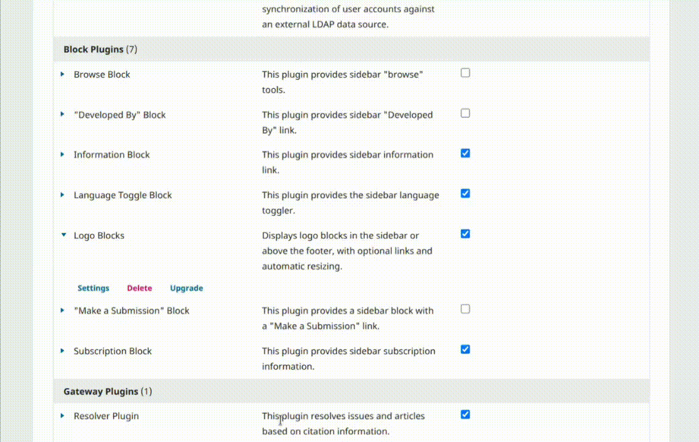

**English** | [Português Brasileiro](docs/README.pt_BR.md) | [Español](docs/README.es.md)

# Logo Blocks

The **Logo Blocks** plugin displays logos on the journal's public pages, in the **sidebar**, in a **strip above the footer**, or in both locations. Each logo can have a link and a short description.

For example, a journal can create an “Indexing services” block with logos and links to its database profiles, and a “Support” block with the institutions that support it. Each journal configures its own blocks, titles, images, and display order.

## Features

- Create multiple blocks, with titles translated into the journal's languages.
- Choose from a logo gallery included with the plugin or upload your own images.
- Reorder, edit, hide, and delete blocks and logos.
- Customize each block's description display and grayscale effect.

**The gallery is an image catalog, not an integration with indexing services.** Selecting a logo does not register the journal in a database, confirm its indexing status, or automatically retrieve its profile address. The journal's team must choose the logos and provide the corresponding links.

Blocks and their logos are displayed on OJS public pages.

## Compatibility

This plugin is compatible with **OJS 3.3**.

## Creating the first block

1. Open **Settings** in the **Logo Blocks** plugin menu.
2. Click **Add block**.
3. Enter a **Block title**, such as “Indexing services”. Use the OJS language selector to fill in the journal's primary language and, optionally, its translations. The limit is 200 characters per language.
4. Under **Block customization**, choose where to display it. By default, new blocks appear in the sidebar, with descriptions hidden and images in color.
5. Click **Save**. In the block list, click the pencil (**Edit**) to open the new block and add its logos.
6. Add at least one logo and check the result on the journal's public page.

The public title follows the language selected by the visitor; if no translation is available, it uses the journal's primary language. **Blocks without logos do not appear on the public page.**

## Adding logos

### Choosing a logo from the gallery

1. Open the block for editing and click **Logo gallery**.
2. Select an image. The link and description fields appear below the gallery. Both are optional.
3. Click **Save**. The logo is added to the end of the list, with the name and acronym defined in the catalog. You can then use **Edit** to adjust these details.

The catalog and its images are bundled with the plugin; images are not downloaded from external services during use. All blocks share this catalog, but each addition saves a processed copy in the journal's public directory. Editing or deleting an added logo does not change the catalog or copies in other blocks or journals.

### Uploading your own image

1. Open the block for editing and click **Add logo**.
2. Enter the **Logo title** and select a PNG, JPEG, or GIF image.
3. Optionally, enter the acronym, link, and description.
4. Check the preview. To remove empty margins, select **Crop borders**.
5. Save the logo form.

Uploaded images are added only to the block being edited; they do not become part of the shared gallery.

### Field reference

| Field | Purpose |
| --- | --- |
| **Logo title** | Required name, up to 200 characters. Used as the image's alternative text and as a tooltip on hover. |
| **Acronym (optional)** | Up to 30 characters. Highlighted in the administration list next to the full name; does not replace the image's alternative text. |
| **Link (optional)** | Address opened in a new tab when the image is clicked. Without a link, the logo is simply an image. |
| **Description (optional)** | Plain text of up to 100 characters, displayed below the image when descriptions are enabled for that location. HTML formatting is not accepted. |

The block title is multilingual. Each logo field has a single value, used in all page languages.

## Customizing the display

Click the block's pencil (**Edit**), adjust the options under **Block customization**, and click **Save**.

| Option | Result on the public page |
| --- | --- |
| **Location** | Blocks can be displayed in the sidebar, footer, or both. The appearance depends on the theme. Keep **Logo Blocks** selected in the sidebar settings even when choosing only the footer. |
| **Descriptions below logos** | Under **Logo description display**, choose **Do not display**, **Show in the journal sidebar**, **Show in the journal footer**, or **Show in both locations**. Descriptions are hidden by default. Selecting Do not display preserves the saved text. |
| **Grayscale** | Select **Enable monochrome mode** and save. The block's logos appear in grayscale in the sidebar and above the footer, returning to color when hovered over or when their links receive keyboard focus. |

## Editing, ordering, and saving

To edit a logo, use **Edit** on its row. You can change its text and link or replace the image. **Leave the file field empty to preserve the current image.**

To reorder logos or blocks, drag the **dotted handle on the left** of the row. You can also focus the handle using the keyboard and use the up and down arrow keys. The order is saved automatically when you drop the item or move it using the keyboard, and applies to both the sidebar and the strip above the footer. New items are added to the end of the list. If saving fails, the screen restores the previous order and reports the error.

## Hiding, disabling, or deleting: what happens?

| Action | Effect | Data preserved? |
| --- | --- | --- |
| Turn off a block's toggle | Hides that block in the sidebar and above the footer. Other blocks keep their own settings. | Yes: logos, text, order, and options. |
| Disable the plugin under **Installed Plugins** | Hides all plugin blocks in that journal. Does not change OJS submissions, reviews, or emails. | Yes: settings and logo files remain stored. |
| Remove **Logo Blocks** from the sidebar settings | Prevents loading through the sidebar, also affecting the strip above the footer. | Yes. |
| Delete a logo | Removes the logo from the block and deletes its public file. | No, for the deleted logo. |
| Delete a block using the trash icon | Removes the block, its settings, all its logos, and their public files. | No, for the deleted block. |

The toggle next to the pencil is **green when the block is enabled** and **gray when disabled**. New blocks start enabled. To display a hidden block again, turn its toggle back on; if you disabled the plugin, enable it again and check that it is selected in the sidebar settings.

**Hiding a block or disabling the plugin does not make its files private.** Images remain in the public directory and can be accessed by anyone with their addresses. To remove a logo and its file through the plugin, delete it.

## Cropping, previews, and image sizes

When uploading or replacing an image, the preview shows how it will be saved. **Crop borders** is initially unchecked: select it to check the cropped result or clear it to return to the uncropped version. Generating a preview does not save the logo; you must confirm the form.

Cropping removes fully transparent or uniformly colored outer margins, such as white or black, before resizing.

## Storage and separation between journals

Each block keeps its own logo list and options. Operations in one journal do not change blocks in other journals. The only shared component is the image catalog bundled with the plugin files.

## License

This plugin is licensed under the GNU General Public License v3.0

Copyright (c) 2013-2026 Lepidus Tecnologia
